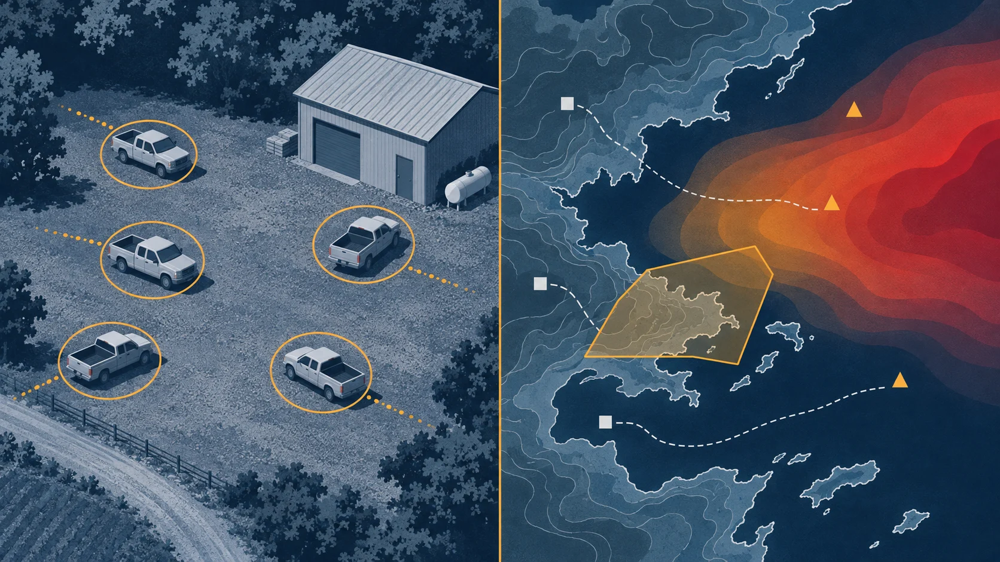
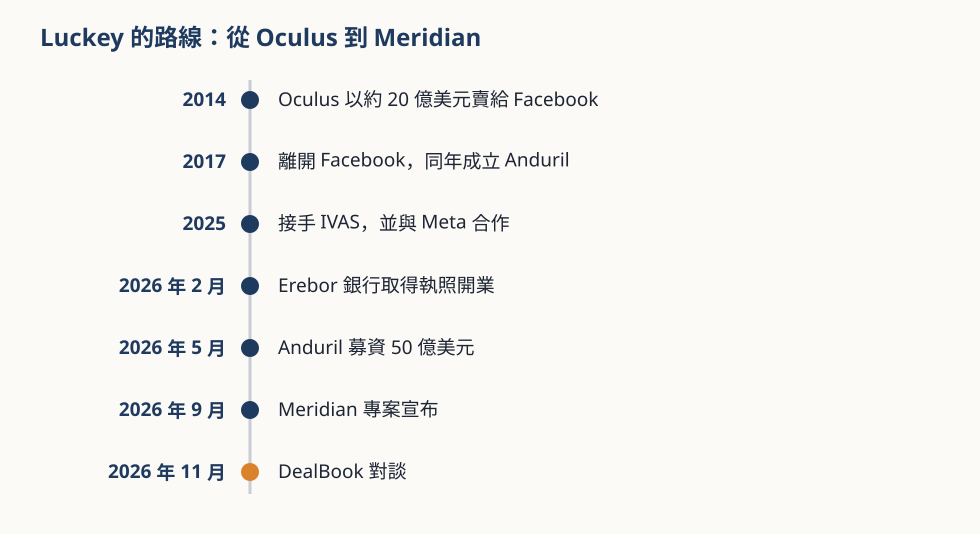
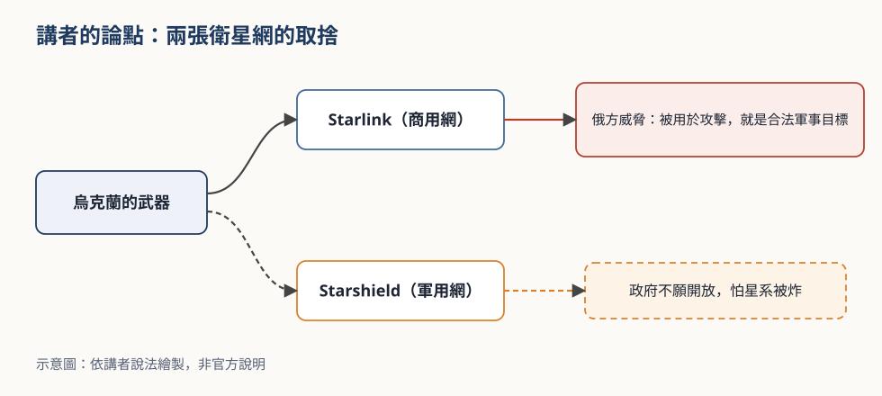
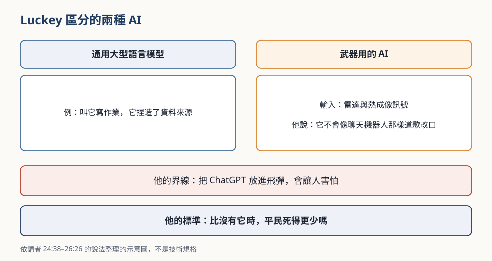
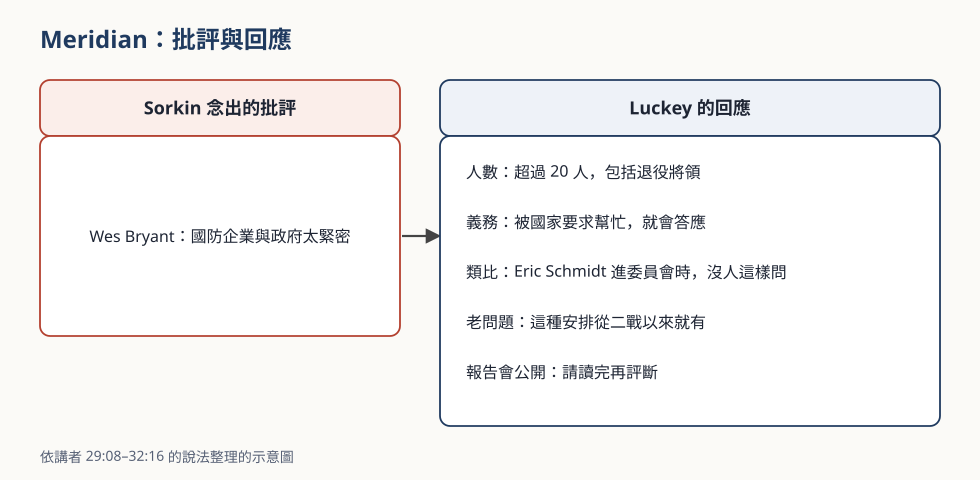

# Palmer Luckey 談 War 2.0：一個軍火商眼中的停電、衛星網與核試驗

> 本導讀的分析與撰稿由 AI 模型完成，不是人類分析，也沒有經過人工逐句校稿，見〈製作說明〉。

*圖說：AI 生成示意。*

影片開頭的蒙太奇打出三個英文字：Drones. Deals. Defense. 接著是幾張報導標題卡、空拍偵測畫面和組裝中的無人機。

*圖說：AI 生成示意，依影片開場 0:09–0:16 畫面重繪。*

主持人 Andrew Ross Sorkin 隨後念出來賓的履歷：大學休學創辦 Oculus，2014 年以 20 億美元賣給 Facebook（[0:54](https://www.youtube.com/watch?v=QARxiqCkJF4&t=54s)），三年後被開除；之後創辦以《魔戒》名劍命名的武器公司 Anduril。Sorkin 還說他今年成了銀行家，銀行以《哈比人》裡堆滿黃金的孤山命名。

*圖：Luckey 從 Oculus 到 Meridian 的經歷時間軸，依公開報導整理，各事件的出處見〈來源清單〉。*

Palmer Luckey 開口的第一句跟戰爭無關：「我必須糾正你。」（[1:35](https://www.youtube.com/watch?v=QARxiqCkJF4&t=95s)）他說孤山在《哈比人》之後依然存在。常有人問他，為什麼要用一座被惡龍搶走黃金的山替銀行命名，他的回答是：他們是惡龍被趕走之後的 Erebor。矮人奪回孤山，「他們守護了它大約 300 年的安全。」（[1:55](https://www.youtube.com/watch?v=QARxiqCkJF4&t=115s)）他補一句：「如果我能做到 300 年的安全，那就相當不錯了」（[1:57](https://www.youtube.com/watch?v=QARxiqCkJF4&t=117s)）。

這個小插曲預告了接下來的 50 分鐘：**Sorkin 每丟出一個題目，Luckey 先拆題目的前提，再用自己的框架回答。** 他自己也提醒台下，聽他說話時要記得「Palmer 是造武器的」（[30:31](https://www.youtube.com/watch?v=QARxiqCkJF4&t=1831s)）。

> 重點：他的論點多半前後一貫，也多半剛好和他的生意站在同一邊。

## 三十秒版

- 他把這陣子的網路中斷，放在 AI 讓攻擊工具更容易做出來的脈絡下解釋；給一般人的建議很老派：備好三天的水、乾糧和處方藥。
- 他願意替國防部改稱戰爭部領一點功勞，理由是嚇阻、預算透明、目標明確，以及讓不想打仗的人自己離開；談伊朗，他認為以最強大的方式打贏，就是對中國最好的嚇阻。
- 談烏克蘭，他替 Musk 與俄方處境做了一段鋼人論證（把對方最強的版本講出來）：衛星網被用於攻擊就會成為目標，而美國政府自己也不肯拿軍用網冒險。
- 他說主流語言模型都管不住，但武器用的感測器 AI 是另一套技術，該問的是有沒有比不用它少死人。
- 他參與五角大廈的 Meridian 未來戰爭研究，Sorkin 當面念出批評者說它體現寡頭政治；他回應這種安排自二戰以來就有，請大家等報告出來再評。
- 他主張恢復核試驗，除了心理上的嚇阻，還有一個無聊得多的理由：測核爆與電磁脈衝對現代電子設備的影響。他也支持公開處決，理由是透明能約束政府濫權；戰爭是否也該轉播，他坦承沒有想得很深。
- 他說中國樂見黃仁勳出局；被 Facebook 開除的事至今沒有釋懷，但他不怪 Zuckerberg。

## 這篇怎麼讀

這是 The New York Times 主辦的 DealBook Summit 舞台訪談，現場錄於 2026 年 11 月 18 日，當天副總統 JD Vance 取消出席，留在華府處理接連發生的服務中斷（[CNBC](https://www.cnbc.com/2026/11/18/trump-tech-outages-nsa-faa-microsoft.html)，二手）；影片隔天上傳（[影片](https://www.youtube.com/watch?v=QARxiqCkJF4)，第一手）。

**Luckey 是賣武器給美國政府的 Anduril 創辦人，報導稱他也是五角大廈 Meridian 研究案的共同主持人；本文把他的預測與評價一律寫成他說或他認為。**

想對照原片的讀者，可以用 [字幕同步播放器](player.html) 邊看影片邊讀中英字幕，或直接讀 [全文譯本](translation-zh.html)。

## 停電那天，他先叫大家備三天的水

Sorkin 從後台的閒聊接下去：Vance 決定留在華府，為服務中斷整天開會，該有多擔心？Luckey 說，先進的 AI 工具讓各種漏洞利用手法更容易做出來，有些出於戰略目的，很多是為了錢；他點名北韓的組織正利用攻防能力的落差牟利。他認為「長遠來看，優勢將歸屬於最有效利用 AI 進行防禦的一方。」（[3:39](https://www.youtube.com/watch?v=QARxiqCkJF4&t=219s)）**他說眼下動作飛快的攻擊者，對上的是跟不上技術的老舊系統**，所以「該是開始全力奔跑的時候了。」（[4:09](https://www.youtube.com/watch?v=QARxiqCkJF4&t=249s)）

Sorkin 順勢問他是不是末日準備者，畢竟他擁有一座地下飛彈基地。Luckey 反而拆了自己的台：「飛彈基地其實是躲避末日相當糟糕的方式」（[4:15](https://www.youtube.com/watch?v=QARxiqCkJF4&t=255s)），因為每個人都知道你在哪裡，而且去 Home Depot 買把軍刀鋸，大約 10 分鐘就能把門的鉸鏈鋸掉。

他真正的建議很平凡：「每個人都該準備 3 天份的水。」（[4:40](https://www.youtube.com/watch?v=QARxiqCkJF4&t=280s)）還有三天份的乾糧，處方藥要在吃完前 72 小時就去領。**他說美國以三天為單位來看很有韌性，但很多東西無法在一天內恢復**，「以前中學都會教這些，而現在每個還記得的人都被當成瘋子。」（[5:05](https://www.youtube.com/watch?v=QARxiqCkJF4&t=305s)）Sorkin 問他會不會印出銀行對帳單，他說系統真崩到那種程度，「我想我的釣竿會比你的銀行對帳單有用得多」（[5:30](https://www.youtube.com/watch?v=QARxiqCkJF4&t=330s)）。

## 改名戰爭部：他願意領一點功勞

Sorkin 說，川普政府把國防部改名為戰爭部，Luckey 可能是推手之一。他回答：「我很樂意領一點功勞。」（[6:05](https://www.youtube.com/watch?v=QARxiqCkJF4&t=365s)）他說這個構想每十年左右就會在專欄裡冒出來，自己不是第一個，但他確實在政權交接期間推動過，還當場翻出和負責交接的霍華德・盧特尼克開會時的筆記。

他說理由沒有按重要性排序。第一是嚇阻：「如果你想要和平，就要為戰爭做好準備。」（[7:09](https://www.youtube.com/watch?v=QARxiqCkJF4&t=429s)）他說名稱應該讓全世界一看就懂用途。

第二是透明與預算。他自稱重視財政紀律的自由意志主義者，認為用防衛當名目，花錢就沒有上限：「花多少錢來防衛自己才算太多？」（[7:38](https://www.youtube.com/watch?v=QARxiqCkJF4&t=458s)）「多少都不算多，對吧？」（[7:42](https://www.youtube.com/watch?v=QARxiqCkJF4&t=462s)）他說，**在醫院和戰爭之間取捨，比在醫院和防衛之間取捨容易得多。**

第三是目標明確。「如果你什麼都想做，你將一事無成。」（[8:04](https://www.youtube.com/watch?v=QARxiqCkJF4&t=484s)）他認為這個部門過去管了太多和作戰只沾一點邊的事，像經濟、國際關係和氣候變遷。

最後兩點跟士氣有關。一是「國防部輸掉了每一場戰爭，而戰爭部贏得了每一場戰爭。」（[8:27](https://www.youtube.com/watch?v=QARxiqCkJF4&t=507s)）二是他口中的 objector repellent，把反對者驅逐出去：組織的工作與國會給的使命都沒變，卻只願替國防部、不願替戰爭部工作的人，本來就不該是作戰能力的基石。「那些因為這個名稱抓狂而離開的人，正好完美印證了我的觀點。」（[9:19](https://www.youtube.com/watch?v=QARxiqCkJF4&t=559s)）

*圖：依 Luckey 在 7:01 到 9:19 的說法整理的示意圖。*

## 伊朗、習近平，和一個他討厭的口號

Sorkin 問到伊朗。他說總統暗示戰爭已經贏了或結束了，但他認為沒人真的相信；又念了前英國軍情六處首長理查・摩爾的看法：習近平正仔細觀察烏克蘭和伊朗，若判定美國沒有決心，可能在台灣問題上誤判。

「聽著，我同意。」（[10:15](https://www.youtube.com/watch?v=QARxiqCkJF4&t=615s)）Luckey 的論點是：「當我們獲勝，而且是以最強大的方式獲勝時，那就是我們對中國等國家能擁有的最佳嚇阻。」（[10:16](https://www.youtube.com/watch?v=QARxiqCkJF4&t=616s)）他說中國從伊朗看到的，大概不是美國最漂亮的成果；但中國看到委內瑞拉，會發現「他們賣去保護委內瑞拉的許多裝備根本不管用」（[10:33](https://www.youtube.com/watch?v=QARxiqCkJF4&t=633s)）。他還說「習近平剛把他所有的高階將領都開除了」（[10:46](https://www.youtube.com/watch?v=QARxiqCkJF4&t=646s)），得先整頓軍隊才能動作；他想美國大概很幸運，這發生在對伊朗動手之前。

談到彈藥庫存，Sorkin 提到總統說可以無限期打下去。Luckey 說「從全球角度來看，這正是美國總統應該說的話」（[11:26](https://www.youtube.com/watch?v=QARxiqCkJF4&t=686s)）：**他的工作是確保彈藥庫是滿的，總統的工作是讓別人不敢攻擊美國。** 他還說「有些人有點把真相奉為至高無上的東西」（[12:08](https://www.youtube.com/watch?v=QARxiqCkJF4&t=728s)），卻沒意識到很多繁榮來自對真相的彈性處理，例子是尼克森的瘋子理論。

Sorkin 提起他的口號「重啟民主兵工廠」（[12:54](https://www.youtube.com/watch?v=QARxiqCkJF4&t=774s)），問川普是否也在做這件事。Luckey 只談兵工廠那一半：其中一些長期武器採購是前所未見的規模，可量產的低成本武器得到投資，更多公司能參與競爭；至於老牌大廠的延誤，「我們談的是幾年到幾十年。」（[13:24](https://www.youtube.com/watch?v=QARxiqCkJF4&t=804s)）民主那一半，他直說很討厭這個詞，「我們是一個共和國，不是民主體制」（[13:41](https://www.youtube.com/watch?v=QARxiqCkJF4&t=821s)）。

## 烏克蘭：他替 Musk 做的鋼人論證

Sorkin 問到烏克蘭，以及川普對普丁的言論。Luckey 先劃清一條線：「這些決定應該由我們的共和國做出，而不是由大企業高層做出」（[14:09](https://www.youtube.com/watch?v=QARxiqCkJF4&t=849s)）。**他認為企業高層不該掌控外交或軍事政策**，「我是一條被鏈子拴住的狗，而且我需要一直被這樣拴著。」（[14:32](https://www.youtube.com/watch?v=QARxiqCkJF4&t=872s)）

他說：「我全力支持烏克蘭，而且比起大多數共和黨人，我大概更站在烏克蘭這邊得多。」（[14:38](https://www.youtube.com/watch?v=QARxiqCkJF4&t=878s)）但他不接受質疑川普立場的說法，認為「川普被逼入了一個不可能的處境。」（[14:53](https://www.youtube.com/watch?v=QARxiqCkJF4&t=893s)）川普第一任期就警告歐洲太依賴俄羅斯石油，當時聯合國的人都在笑他。他說「自烏克蘭戰爭爆發以來，德國送給俄羅斯的錢比送給烏克蘭的還多」（[15:20](https://www.youtube.com/watch?v=QARxiqCkJF4&t=920s)）。

話題轉到 Musk 在烏克蘭限制 Starlink 速度的爭議。Luckey 先說「我個人滿喜歡這傢伙的，所以聽聽就好，請大打折扣。」（[17:31](https://www.youtube.com/watch?v=QARxiqCkJF4&t=1051s)）再區分兩種決定：武器賣給誰由政府決定，「如果我自己做那個決定，我會去坐牢。」（[17:47](https://www.youtube.com/watch?v=QARxiqCkJF4&t=1067s)）但他說，**公司願意為別國把自己的民用基礎設施冒險到什麼程度，目前通常不是政府在管**。

「讓我為這件事做個鋼人論證。」（[18:02](https://www.youtube.com/watch?v=QARxiqCkJF4&t=1082s)）Luckey 模擬俄方的說法：「如果你們允許 Starlink 衛星星系被用於針對我國的進攻性軍事行動，我就要摧毀它」（[18:14](https://www.youtube.com/watch?v=QARxiqCkJF4&t=1094s)），知情放行就不能再說它是民用設施。他說衛星繞著整個地球轉，「繞行美國的那些衛星，就是繞行烏克蘭的同一批衛星」（[18:33](https://www.youtube.com/watch?v=QARxiqCkJF4&t=1113s)）。

在他的推演裡，Musk 的選擇是：「我是要挺身維護民主，然後順便毀掉許多依賴這些相同衛星的美軍作戰能力？」（[19:15](https://www.youtube.com/watch?v=QARxiqCkJF4&t=1155s)）還是針對這個區域限速。他說「我的某些系統正是使用那些完全相同的鏈路」（[19:31](https://www.youtube.com/watch?v=QARxiqCkJF4&t=1171s)），但烏克蘭確實有進攻性武器靠民用 Starlink 攻擊俄羅斯。

Sorkin 追問，太空網路是不是永遠都有這個風險。Luckey 說這有程度之分，就像民用橋梁算不算合法軍事目標一直有爭論。他的立場是：美國若要求 SpaceX 這麼做，就有義務協助防衛衛星星系並警告俄羅斯；把責任外包給企業高層、對方不配合又發怒，「在我看來這根本站不住腳。」（[21:05](https://www.youtube.com/watch?v=QARxiqCkJF4&t=1265s)）

*圖：依 Luckey 在 18:14 到 21:47 的說法繪製的示意圖，呈現他口中兩張衛星網的取捨，不是官方說明。*

「其實我還該指出最後一件事。」（[21:09](https://www.youtube.com/watch?v=QARxiqCkJF4&t=1269s)）他說除了 Starlink，還有 SpaceX 的軍用版衛星網 Starshield，照他的說法由國防部擁有並營運、SpaceX 協助。他說美國大可讓烏克蘭用 Starshield 跑所有武器，但政府不肯，「因為他們知道這樣一來俄羅斯就會炸毀 Starshield，而美軍就沒得用了。」（[21:34](https://www.youtube.com/watch?v=QARxiqCkJF4&t=1294s)）

> 重點：在他看來，政府自己都不冒險，憑什麼要 Musk 犧牲民用網？

他再往上推一層：「西方其實根本沒有人希望烏克蘭贏」（[21:55](https://www.youtube.com/watch?v=QARxiqCkJF4&t=1315s)），只希望它撐著不輸，「這是一種詭異又荒謬的作戰立場」（[21:59](https://www.youtube.com/watch?v=QARxiqCkJF4&t=1319s)）。

## 模型管不住，飛彈上的 AI 是另一回事

Sorkin 從 Anthropic 談起：他說五角大廈把 Anthropic 列為供應鏈風險，接著就找上 OpenAI，問這些模型能不能被人或政府控制。Luckey 答：「不受控。每個主流模型在幾個月內都在某種程度上被越獄了。」（[22:56](https://www.youtube.com/watch?v=QARxiqCkJF4&t=1376s)）他說真正的問題是好人能不能跑在惡意用途前面，「相較於會毀滅我們所有人的超級智慧，我更害怕的是極其險惡的壞人掌握了相當不錯的 AI。」（[23:12](https://www.youtube.com/watch?v=QARxiqCkJF4&t=1392s)）

他不擔心 AI 失控暴走：「你可以關掉資料中心。」（[23:30](https://www.youtube.com/watch?v=QARxiqCkJF4&t=1410s)）他說 AI 至少目前在實體世界沒有實質的手腳，「Skynet 也許已經上線了，但它無法取得有用的工具，因為我們根本還沒打造出那些有用的工具」（[23:39](https://www.youtube.com/watch?v=QARxiqCkJF4&t=1419s)）。至於街上有 10 億台人形機器人的時候，「是的，那會是個不同的世界。」（[23:51](https://www.youtube.com/watch?v=QARxiqCkJF4&t=1431s)）

Sorkin 轉到他的本業：Anduril 在做自主武器。Luckey 說「我在這些搞 AI 的人之前就是個搞 AI 的人了」（[24:16](https://www.youtube.com/watch?v=QARxiqCkJF4&t=1456s)）。他把武器用的 AI 和通用大型語言模型分開談。他說有人抱怨叫 AI 寫作業，它捏造來源害自己拿 F，「你知道當你的 AI 在飛彈上發生同樣的事會怎樣嗎？」（[25:01](https://www.youtube.com/watch?v=QARxiqCkJF4&t=1501s)）**他的答案是不會出同一種錯**：「正在接收雷達訊號、熱成像訊號的 AI」（[25:04](https://www.youtube.com/watch?v=QARxiqCkJF4&t=1504s)）分析的是驅逐艦的電磁訊號，不會像聊天機器人那樣道歉改口；它也比只會找最熱目標衝過去的舊式尋標器可靠得多。

*圖：依 Luckey 在 24:38 到 26:26 的說法整理的示意圖，不是技術規格。*

「對於平民附帶損害，我對傳統無導引武器的恐懼遠遠大於對智慧武器的恐懼。」（[25:35](https://www.youtube.com/watch?v=QARxiqCkJF4&t=1535s)）他也承認界線：「如果我只是把 ChatGPT 放進飛彈的彈頭裡，你會害怕是對的。」（[25:42](https://www.youtube.com/watch?v=QARxiqCkJF4&t=1542s)）而且「確實有人把 LLM 用於目標鎖定，而且犯了錯誤。」（[25:51](https://www.youtube.com/watch?v=QARxiqCkJF4&t=1551s)）他說自己不這麼做，也不點名別家。

**他的標準是拿來跟沒有它的世界比**：「即使它犯了錯，死亡的平民是否還是比原本可能會死的人數要少？」（[26:12](https://www.youtube.com/watch?v=QARxiqCkJF4&t=1572s)）他說，就像沒人滿足於自駕車只比人類好一點，大家要它好上一百倍，軍方面對的也是這種要求。他的結論是：就算讓人彆扭，「我不認為為了避免心裡不舒服，有任何數量的人死亡是可以接受的」（[26:44](https://www.youtube.com/watch?v=QARxiqCkJF4&t=1604s)）。

## Meridian：他說要研究 2050 年的戰爭，以及被念到臉上的批評

Meridian 是國防部長 Hegseth 9 月 30 日演說中宣布的研究案（[army.mil](https://www.army.mil/article/295897)，官方）。Sorkin 問他在這 120 天裡向 Hegseth 建議了什麼（[26:51](https://www.youtube.com/watch?v=QARxiqCkJF4&t=1611s)）。Luckey 先澄清：「Meridian 專案是要我們探討 2050 年的戰爭可能呈現什麼樣貌」（[27:01](https://www.youtube.com/watch?v=QARxiqCkJF4&t=1621s)）。被質疑懂不懂國防生產，他說「我製造了價值數十億美元的武器」（[27:14](https://www.youtube.com/watch?v=QARxiqCkJF4&t=1634s)），但他認為「他們招募我們，同樣也幾乎是著眼於科幻的角度」（[27:17](https://www.youtube.com/watch?v=QARxiqCkJF4&t=1637s)）。他說研究由非營利研究機構 MITRE 主持，自己前一天剛在夏安山開完會。

那場會定下的方向是：「我們必須聚焦在那些目前還沒有有力倡導者的事物上」（[27:54](https://www.youtube.com/watch?v=QARxiqCkJF4&t=1674s)）。**他說報告若只叫政府多買殺人機器人就是浪費時間**，「大家都早就知道我們需要更多殺人機器人了。」（[28:08](https://www.youtube.com/watch?v=QARxiqCkJF4&t=1688s)）他透露的例子是氣象控制，例如讓雨落在海上、好看清目標；他說「部裡根本沒有什麼氣象控制辦公室」（[28:51](https://www.youtube.com/watch?v=QARxiqCkJF4&t=1731s)）。

Sorkin 也把批評念了出來，來自退役空軍士官長 Wes Bryant（曾主持五角大廈平民傷亡評估）：Meridian 體現了「接管我們政府的腐敗與寡頭政治」（[29:32](https://www.youtube.com/watch?v=QARxiqCkJF4&t=1772s)），國防企業和政府太過緊密。

Luckey 先說「我尊敬他的服役貢獻，他也是從一個合理的角度切入」（[29:50](https://www.youtube.com/watch?v=QARxiqCkJF4&t=1790s)）。他說成員超過 20 人，包括受尊敬的退役將領，「所以這並不是只有一群科技新貴在掌舵。」（[30:18](https://www.youtube.com/watch?v=QARxiqCkJF4&t=1818s)）至於為什麼要接，「如果你被要求幫助你的國家，你一定會答應。」（[30:21](https://www.youtube.com/watch?v=QARxiqCkJF4&t=1821s)）

他反過來指出雙重標準。他說 Eric Schmidt 當年進國防創新委員會時，沒人會這樣問，而且把話直接丟給 Sorkin：「你絕不可能在拜登任內、Eric Schmidt 擔任國防創新委員會成員時問他這個問題，對吧？」（[30:39](https://www.youtube.com/watch?v=QARxiqCkJF4&t=1839s)）他把 Schmidt 說成拜登任內進委員會，與公開資料不符，見〈對照公開資料〉。**在他看來，這種安排就算是問題，也是個老問題**，「這從第二次世界大戰以來就一直存在。」（[31:11](https://www.youtube.com/watch?v=QARxiqCkJF4&t=1871s)）他覺得那類攻擊「非常、非常有黨派色彩」（[31:32](https://www.youtube.com/watch?v=QARxiqCkJF4&t=1892s)），最後請大家讀報告：「去讀它、看看它，我想等我們完成時，你們可以決定我們是否毀了這個國家。」（[32:16](https://www.youtube.com/watch?v=QARxiqCkJF4&t=1936s)）

*圖：依 Luckey 在 29:08 到 32:16 的說法整理的示意圖。*

## 核試驗：他想知道手機撐不撐得住

Sorkin 說 Luckey 主張重啟核武試驗，這也會嚇壞很多人。Luckey 先打預防針：「其中有些理由還遠不夠成熟，而且我不是這方面的專家。」（[32:47](https://www.youtube.com/watch?v=QARxiqCkJF4&t=1967s)）

第一個理由偏心理學。他有個工作假說：「相互保證毀滅仰賴大眾層面在心理上對核武器威力的某種信任」（[32:51](https://www.youtube.com/watch?v=QARxiqCkJF4&t=1971s)）。他說大家都怕核武時，相互保證毀滅能發揮嚇阻作用，「但當人們不害怕時，我們沒有任何證據證明它依然有效。」（[33:07](https://www.youtube.com/watch?v=QARxiqCkJF4&t=1987s)）他認為連試驗都不願做，會讓這個概念失去可信度。

他說還有一個理由「無聊得多」（[33:26](https://www.youtube.com/watch?v=QARxiqCkJF4&t=2006s)）：**要測的是核爆對軍隊和社會所依賴的技術造成的影響。** 他說 60 年代到 90 年代初，美國幾乎每次試驗都會擺上一排排民用皮卡、軍用無線電、洗衣機和呼吸器，觀察的不只是爆炸與高溫，「還有電子效應」（[34:10](https://www.youtube.com/watch?v=QARxiqCkJF4&t=2050s)）。「什麼是電磁脈衝？寬頻電磁脈衝，不是像定向能微波武器那種東西，而是寬頻的大規模脈衝。」（[34:16](https://www.youtube.com/watch?v=QARxiqCkJF4&t=2056s)）電磁脈衝是核爆瞬間放出的強烈電磁波，會讓電子設備當機甚至燒毀。他說，當年的試驗就是看哪些撐得住、哪些當機但能重開、哪些徹底燒毀，再據此花大錢加固軍事、電力和醫院設施。

他說問題是這些試驗已經停了幾十年，用來模擬核爆對電子設備影響的模型，針對的電晶體「實際上比這支手機裡的電晶體大上數千倍」（[34:56](https://www.youtube.com/watch?v=QARxiqCkJF4&t=2096s)）。「我們實際上不知道我們的手機、關鍵基礎設施和軍隊會發生什麼事。」（[35:07](https://www.youtube.com/watch?v=QARxiqCkJF4&t=2107s)）

*圖說：AI 生成示意，依講者描述繪製。*

他再站到敵人那一邊設想：**如果能讓整個區域的美軍失去任務能力卻不殺人，那很誘人**，因為殺死數千名美國人會引發全面報復。他舉的假想例子是中國在太空試爆、當量意外波及朝鮮半島，北韓同時用沒受影響的火砲南侵，美國和南韓都無能為力。他說「我也沒有信心我的裝備能夠存活」（[36:33](https://www.youtube.com/watch?v=QARxiqCkJF4&t=2193s)），因為現行加固指南是為老技術寫的，「它們是針對亞伯拉罕・林肯那個年代會用的那種手機而設計的。」（[36:42](https://www.youtube.com/watch?v=QARxiqCkJF4&t=2202s)）

## 公開處決與看得見的戰爭

時間快到了，Sorkin 說還有三個簡短的問題。第一個是死刑：他說近期原本可能有一場電視轉播的處決，而 Luckey 公開表示支持。Sorkin 指的是 Nidal Hasan 的軍事處決，預定 12 月 3 日執行，川普 10 月 15 日已表示不會直播（[DPIC](https://deathpenaltyinfo.org/news/president-trump-announces-the-military-will-not-publicly-livestream-nidal-hasans-execution)，二手）。Luckey 先前在 X 上主張處決應該公開而殘酷（[dnyuz 轉載 Business Insider](https://dnyuz.com/2026/10/12/palmer-luckey-says-that-executions-should-be-public-and-brutal/)，二手）。

他說「這其實不是 Palmer Luckey 獨有的觀點」（[37:07](https://www.youtube.com/watch?v=QARxiqCkJF4&t=2227s)），自由意志主義者常見的立場是國家應該極少執行死刑，甚至完全不執行。他說真要執行，就是終極懲罰，「不應該是被醫療化、隱藏起來並淡化的事情」（[37:20](https://www.youtube.com/watch?v=QARxiqCkJF4&t=2240s)）。他反對由醫生打一針讓人安詳離世，主張由握有合法暴力的執法與軍事機構執行並讓大眾看見：看的人要嘛震驚於殺錯了人，要嘛認為罪有應得。

Sorkin 問這是不是一種嚇阻。他說嚇阻只是其中一部分，他指的是「對政府胡作非為、失控的嚇阻」（[38:23](https://www.youtube.com/watch?v=QARxiqCkJF4&t=2303s)）。「控制死刑濫用的關鍵，就是這項做法的透明度。」（[38:28](https://www.youtube.com/watch?v=QARxiqCkJF4&t=2308s)）政府要殺人，「他們就必須願意把他推到大眾面前」（[38:39](https://www.youtube.com/watch?v=QARxiqCkJF4&t=2319s)）。**他說美國很多州廢除死刑，正是因為公開處決了大多數人認為不該死的人，這本來就是制衡的方式。**

Sorkin 把問題推向戰爭：戰爭是否也該即時讓人看見？Luckey 說：「我必須承認，我對這個問題沒有想得很深入。」（[39:18](https://www.youtube.com/watch?v=QARxiqCkJF4&t=2358s)）他記得越戰轉播大幅壯大了反戰運動，而波灣戰爭的公開反而讓人覺得那是一場正當的仗。所以他傾向更多透明，「你越是依賴政府宣傳管道作為唯一的真實來源，問題就越大」（[40:20](https://www.youtube.com/watch?v=QARxiqCkJF4&t=2420s)）。

有人說他只是想重現羅馬競技場，他否認，說**他要的是制衡政府的權力**，而他相信唯一的辦法是在適當的時候讓民眾動起情緒。

## 海上平台：被當成資料中心的老計畫

Sorkin 說，Musk 想把資料中心搬上太空，Luckey 想搬到海上。Luckey 說這只是一個很小的押注，而且前一天才第一次公開談：「我昨天談過這件事。」（[41:07](https://www.youtube.com/watch?v=QARxiqCkJF4&t=2467s)）Engadget 11 月 18 日報導了他在 X 上介紹的 SLAB 構想，他否認那只是漂浮式 AI 資料中心（[Engadget](https://engadget.com/2320221/palmer-luckeys-slab-seastead-is-way-cooler-than-a-floating-data-center)，二手）。

**他說的平台，是用來放美國需要、但大家不想放在自家後院的產業**，主因是州與地方法規和反對聲浪：金屬礦石加工、化學工程、煉油和海水淡化。「例如加州需要水，但他們不希望沿海有海水淡化廠」（[41:29](https://www.youtube.com/watch?v=QARxiqCkJF4&t=2489s)）。對於外界把它說成追趕 AI 熱潮，他說「我做這個大概有 10 年了」（[41:54](https://www.youtube.com/watch?v=QARxiqCkJF4&t=2514s)），AI 資料中心熱潮退了他也無所謂，「我其實更傾向於認為大多數 AI 都將在本地端運作」（[42:00](https://www.youtube.com/watch?v=QARxiqCkJF4&t=2520s)）。

*圖說：AI 生成示意，依講者描述繪製，不是 Luckey 公開的渲染圖。*

資料中心在他眼裡也是同一類東西：大家想用 YouTube、Instagram，想用 ChatGPT 寫作業，「他們只是不希望大聲咆哮的巨大資料中心出現在自己的地盤上。」（[42:31](https://www.youtube.com/watch?v=QARxiqCkJF4&t=2551s)）所以他說，「我和太空派是同一枚硬幣的兩面」（[42:43](https://www.youtube.com/watch?v=QARxiqCkJF4&t=2563s)）。

## 黃仁勳：中國想讓他走，所以他希望他留下

Sorkin 提到 Luckey 評論黃仁勳下台時說這是中國贏了；Nvidia 董事會 11 月 11 日接受黃仁勳辭去執行長（[SEC 8-K](https://www.sec.gov/Archives/edgar/data/0001045810/000104581026000082/nvda-20261111.htm)，官方）。

Luckey 的說法很直接：「中國希望黃仁勳出局，所以我希望他留任」（[43:00](https://www.youtube.com/watch?v=QARxiqCkJF4&t=2580s)）。他先說清楚，自己並不認同黃仁勳在美中經濟關係上的一些關鍵想法，「例如我認為我們不應該向中國出口晶片。」（[43:18](https://www.youtube.com/watch?v=QARxiqCkJF4&t=2598s)）他承認對方論點合理，只是自己不站那邊。

有人反駁說 Nvidia 一直在幫中國，他認為這些人沒看懂：「中國並不希望 Nvidia 把 GPU 賣給中國企業」（[43:44](https://www.youtube.com/watch?v=QARxiqCkJF4&t=2624s)）。**他說現在有 60 萬顆 H200 卡在港口，中國不發進口許可，因為北京想建立自己的半導體產業。**（[43:55](https://www.youtube.com/watch?v=QARxiqCkJF4&t=2635s)） 在他看來，「黃仁勳基本上是站在中國 AI 企業那一邊，而不是站在中國政府那一邊」（[44:23](https://www.youtube.com/watch?v=QARxiqCkJF4&t=2663s)），所以中國樂見他出局；他還說，這件事讓 Nvidia 市值蒸發約 1 兆美元（[44:32](https://www.youtube.com/watch?v=QARxiqCkJF4&t=2672s)）。

他希望黃仁勳留任，理由之一是個人關係：「他的人脈關係正是大家願意跟他做生意的原因，因為紙本合約毫無意義」（[45:00](https://www.youtube.com/watch?v=QARxiqCkJF4&t=2700s)），合約只給你事後告人的權利。「在這個關鍵時刻，沒有人能取代黃仁勳的位置。」（[45:20](https://www.youtube.com/watch?v=QARxiqCkJF4&t=2720s)）

## 被 Facebook 開除，以及和 Zuckerberg 再聯手

最後一題，Sorkin 問他事後回看，被 Facebook 開除是高興還是難過。Luckey 說這件事比較屬於藏在心底的那種。他的道德哲學是：「評價一個人應該根據他們當時行動的背景脈絡，而不是事後諸葛」（[45:55](https://www.youtube.com/watch?v=QARxiqCkJF4&t=2755s)）；結果後來變好，不代表當初做得對。「而我並不是個寬宏大量的人。」（[46:46](https://www.youtube.com/watch?v=QARxiqCkJF4&t=2806s)）

他說的經過是：2016 年大選期間他捐錢給一個挺川普的團體，「接著我被停職，然後就被開除了。」（[47:02](https://www.youtube.com/watch?v=QARxiqCkJF4&t=2822s)）他說原因不是別的，他的考績很好，「我依然記得我 2016 年上半年的考績。」（[47:16](https://www.youtube.com/watch?v=QARxiqCkJF4&t=2836s)）

有人說，沒有被開除就不會有 Anduril。他說：「這確實沒錯，但我仍然感到非常介意」（[47:38](https://www.youtube.com/watch?v=QARxiqCkJF4&t=2858s)），尤其是那些他幫忙賺了幾億美元的人。「我創辦 Oculus 時才 19 歲」（[47:46](https://www.youtube.com/watch?v=QARxiqCkJF4&t=2866s)），住在露營拖車裡，那些人從一開始就一起工作，「他們卻認定我是套在他們脖子上的沉重枷鎖，並把我甩掉了」（[47:52](https://www.youtube.com/watch?v=QARxiqCkJF4&t=2872s)）。「所以，我被開除大概對大家都更好。」（[47:58](https://www.youtube.com/watch?v=QARxiqCkJF4&t=2878s)）「但我始終沒有釋懷。」（[48:03](https://www.youtube.com/watch?v=QARxiqCkJF4&t=2883s)）

Sorkin 問他怎麼又和 Mark Zuckerberg 合作了。Luckey 說，Anduril 接手了陸軍苦戰多年的 IVAS 頭戴顯示計畫，替士兵顯示來襲威脅、安全區域，並提供熱成像與夜視。

他說：「事實上，開除我的並不是 Mark Zuckerberg。」（[48:54](https://www.youtube.com/watch?v=QARxiqCkJF4&t=2934s)）在龐大的組織裡，「我頂多就像是他每日簡報裡的一條更新事項。」（[49:01](https://www.youtube.com/watch?v=QARxiqCkJF4&t=2941s)）他的說法是，幾千人部門的主管說非開除不可，執行長的職責「可不是去推翻往下一級、兩級、三級主管傳達給他的訊號」（[49:31](https://www.youtube.com/watch?v=QARxiqCkJF4&t=2971s)）。他說兩人見面「大概十來次吧。」（[49:52](https://www.youtube.com/watch?v=QARxiqCkJF4&t=2992s)）

**他真正記恨的，是那些和他熬夜趕 CES、由他提拔和保護過的人**：他們曾一起「一邊吃著難吃的韓國料理」（[50:05](https://www.youtube.com/watch?v=QARxiqCkJF4&t=3005s)）衝刺趕工，「那些人才是真正讓我痛恨的人。」（[50:21](https://www.youtube.com/watch?v=QARxiqCkJF4&t=3021s)）至於 Zuckerberg，「他就像是一股自然之力。」（[50:29](https://www.youtube.com/watch?v=QARxiqCkJF4&t=3029s)）

所以只要他賣給 Meta 的技術和智慧財產權能授權給陸軍、幫士兵活下來，他就會做這筆交易。「我不是那麼心胸狹窄的人」（[50:53](https://www.youtube.com/watch?v=QARxiqCkJF4&t=3053s)），「有時候你必須做正確的事」（[51:04](https://www.youtube.com/watch?v=QARxiqCkJF4&t=3064s)）。對談停在這裡。

## 對照公開資料：幾個值得補充的地方

以下只列和公開資料有實質出入、或需要補口徑的說法；講者的預測與評價不在此列。

### 說法與公開資料不符或過頭

- Eric Schmidt 的任期：Luckey 說 Schmidt 是拜登任內進國防創新委員會；公開資料是委員會 2016 年成立，Schmidt 是首任主席，任到 2020 年 9 月（[Wikipedia](https://en.wikipedia.org/wiki/Defense_Innovation_Board)，二手）。
- 習近平與將領：Luckey 說習近平剛把所有高階將領開除；智庫分析是整肅自 2022 年後持續數年，到 2026 年初中央軍委七席只剩兩人，說所有將領都剛被撤換是說過頭了（[CSIS](https://www.csis.org/analysis/assessing-xis-unprecedented-purges-chinas-military-key-developments-and-potential)，二手）。
- 德國與俄羅斯：Luckey 說開戰以來德國付給俄羅斯的錢比給烏克蘭的多。沒有找到德國單一國家的累計對照；歐洲整體開戰以來付俄的化石燃料款（2,310 億歐元）仍高於援烏（2,007 億歐元），但自 2023 年起援烏已超過付俄，德國也已停止進口俄國化石燃料（[Kyiv Post](https://www.kyivpost.com/amp/post/71715)，二手）。

### 口徑補充

- 戰爭部：主持人在提問時把國防部說成已經改名；2025 年 9 月 5 日的行政命令只讓戰爭部成為第二名稱，法定名稱仍要國會立法才能改（[白宮行政命令](https://www.whitehouse.gov/presidential-actions/2025/09/restoring-the-united-states-department-of-war/)，官方）。
- Anduril 估值：主持人開場說 Anduril 估值 900 億美元，這是員工股份轉讓的定價（[Tech Funding News](https://techfundingnews.com/from-61b-to-90b-in-five-months-inside-andurils-1-3b-employee-tender-offer/)，二手、單方）；公司 5 月募資 50 億美元時的估值是 610 億美元（[TechCrunch](https://techcrunch.com/2026/05/13/anduril-raises-5b-doubles-valuation-to-61b/)，二手）。
- H200：Reuters 引匿名知情人士稱約 60 萬顆存放在香港，等北京放行，與 Luckey 所說大致一致（[Devdiscourse 轉載 Reuters](https://www.devdiscourse.com/article/international/4002037-exclusive-nvidia-chips-pile-up-in-hong-kong-as-china-withholds-import-approval)，二手、單方）。
- 服務中斷：國家情報總監 Jay Clayton 說這波中斷不是網路攻擊，也不是國家層級的協同行動；匿名官員說起因是系統升級（[CNBC](https://www.cnbc.com/2026/11/18/trump-tech-outages-nsa-faa-microsoft.html)，二手）。
- Starlink 限速：事件發生在 10 月中；Musk 在 X 上說，速度或用量的限制由美軍、最終由美國總統決定（[Al Jazeera](https://www.aljazeera.com/news/2026/10/14/ukraine-accuses-elon-musks-spacex-of-throttling-starlink-terminals)，二手）。

### 後續進展

- 處決直播：川普已表示 Hasan 的處決不會直播，見〈公開處決與看得見的戰爭〉。
- Meridian：報導統計成員 21 至 22 人，與 Luckey 說的超過 20 人一致；11 月，CREW 等團體就 Meridian 的透明度與成員組成提告（[Army Times](https://www.armytimes.com/news/pentagon-congress/2026/11/13/lawsuit-says-pentagons-future-warfare-panel-lacks-transparency-and-balance/)，二手）。

## 讀這場訪談要記得的限制

- 單一視角，很多內容只有他的說法。整場只有 Luckey 一位來賓，主持人雖然念了批評、追問了利益衝突，批評者本人不在場。在夏安山開會、與盧特尼克開會、被開除的原因、Zuckerberg 沒有參與決定，目前都只有他本人的陳述；Sorkin 念的 Bryant 批評，本文沒有找到原始出處。
- 利害關係。**Anduril 的營收來自國防採購，他又在替國防部規劃未來戰爭**；他主張的低成本自主武器、恢復核試驗、加固電子設備，都和他的事業方向一致。
- 時效。訪談在 2026 年 11 月 18 日，談到的服務中斷、Nvidia 人事、處決與 Meridian 訴訟都還在發展，本文只依 11 月 21 日前的公開資料。

## 重點結論與實際啟示

開場那招先拆前提，他用了一整場：改名、Starlink、被開除，都是先換題目再回答。

評估武器 AI 時，他給了一個可以拿來反問他的標準：**跟沒有它的世界比，有沒有少死人、少毀設施**；這要靠公開資料檢驗，不能只靠廠商自評。公開處決和恢復核試驗，他的理由都指向透明與可驗證。

**整場一再繞回同一個問題：誰該做決定。** 他說武器賣給誰、要不要為別國承擔風險，應該由共和國決定，企業高層不該插手，自己是被拴住的狗。可是同一場對談裡，他也說自己推動了部門改名、在幫國防部規劃 2050 年的戰爭、認為被國家徵召就該答應。

> 重點：他說共和國該做決定，而他自己就在替共和國做決定的那個房間裡。

Sorkin 念的那段批評，問的正是這件事。

## 製作說明：這篇導讀由 AI 模型完成

本導讀的分析與撰稿由 AI 模型完成，不是人類分析，也沒有經過人工逐句校稿。主控是 Claude Sonnet 5.5。影片的聆聽與畫面盤點由 agy 的 Gemini 4 Hydrogen 完成；逐句中文翻譯由 agy 的 Gemini 3.8 Flash 完成，再由 Sonnet 逐章修詞、Opus 統一審查；本文由 Opus 綜合字幕與查證結果撰稿，之後共經兩輪 Opus 依總編輯準則潤稿並標示重點；LINE 短版分享文由第二輪的同一位 Opus 潤稿。

字幕是 YouTube 機器字幕，沒有說話者標記，說話者依音訊與上下文判斷。中文由 AI 翻譯，可能有誤；少數句子的中文依 AI 聆聽結果修正，與英文欄的機器字幕用字不同，這類句子本文只意譯、不當直接引言。字幕與譯文沒有經過人工逐句校對，也沒有逐句對照原音。引言的中文是翻譯，不是講者原話；每個直接引言附一個影片時間戳，轉述不附。影片沒有官方章節，播放器與譯本用的 12 段章節是自訂的，正文再依談話順序合併。重要說法須有兩方以上查證與一手來源，只有單方者降級標示；講者的預測、評價與個人經歷只標為他的說法。

封面、感測器畫面、電磁脈衝與海上平台四張插畫由 codex exec 呼叫 imagegen 生成，圖內沒有文字，都是示意圖，不是影片畫面或產品畫面；時間軸、衛星網、兩種 AI 對照、戰爭部五個理由與 Meridian 批評回應五張圖是以腳本自繪的 SVG，文字依講者說法整理。完整中文譯本見 [全文譯本](translation-zh.html)，中英對照可用 [字幕同步播放器](player.html)。

## 來源清單

- Palmer Luckey on War 2.0，New York Times Events（DealBook Summit 2026），2026-11-19 上傳，第一手：[https://www.youtube.com/watch?v=QARxiqCkJF4](https://www.youtube.com/watch?v=QARxiqCkJF4)
- Restoring the United States Department of War（Executive Order 14347），White House，2025-09-05，官方：[https://www.whitehouse.gov/presidential-actions/2025/09/restoring-the-united-states-department-of-war/](https://www.whitehouse.gov/presidential-actions/2025/09/restoring-the-united-states-department-of-war/)
- Hegseth delivers 'State of the Force' address, outlines series of new initiatives，army.mil，2026-10-02，官方：[https://www.army.mil/article/295897](https://www.army.mil/article/295897)
- NVIDIA Form 8-K，SEC EDGAR，2026-11-12 提交（事件日 2026-11-11），官方：[https://www.sec.gov/Archives/edgar/data/0001045810/000104581026000082/nvda-20261111.htm](https://www.sec.gov/Archives/edgar/data/0001045810/000104581026000082/nvda-20261111.htm)
- Oculus 創辦人 Palmer Luckey 談 AI 武器與烏克蘭（含 2014 年以約 20 億美元出售 Oculus），NPR，2024-07-09，二手：[https://npr.org/2024/07/09/nx-s1-4985981/oculus-ai-weapons-ukraine-palmer-luckey](https://npr.org/2024/07/09/nx-s1-4985981/oculus-ai-weapons-ukraine-palmer-luckey)
- Embattled Oculus co-founder Palmer Luckey leaves Facebook，TechCrunch，2017-03-30，二手：[https://techcrunch.com/2017/03/30/palmer-luckey-facebook](https://techcrunch.com/2017/03/30/palmer-luckey-facebook)
- Anduril（2017 年成立）公司介紹，CNBC Disruptor 50，二手：[https://www.cnbc.com/id/107048350](https://www.cnbc.com/id/107048350)
- Erebor Bank 取得全國銀行執照，Banking Dive，2026-02-09，二手：[https://bankingdive.com/news/erebor-bank-receives-national-bank-charter/811724/](https://bankingdive.com/news/erebor-bank-receives-national-bank-charter/811724/)
- Vance scraps schedule to address tech outages as Trump admin insists incidents aren't linked，CNBC，2026-11-18，二手：[https://www.cnbc.com/2026/11/18/trump-tech-outages-nsa-faa-microsoft.html](https://www.cnbc.com/2026/11/18/trump-tech-outages-nsa-faa-microsoft.html)
- Musk, Luckey and Gingrich get 120 days to map America's future wars，TNW，2026-09-30，二手：[https://thenextweb.com/news/pentagon-project-meridian-musk-luckey-gingrich](https://thenextweb.com/news/pentagon-project-meridian-musk-luckey-gingrich)
- Project Meridian 成員名單與 MITRE 執行的報導，Defense Daily，2026-10-06，二手：[https://www.defensedaily.com/tech-execs-former-defense-officials-picked-for-pentagons-project-meridian-future-warfare-panel/pentagon/](https://www.defensedaily.com/tech-execs-former-defense-officials-picked-for-pentagons-project-meridian-future-warfare-panel/pentagon/)
- CREW 等團體就 Project Meridian 提告的報導，Army Times，2026-11-13，二手：[https://www.armytimes.com/news/pentagon-congress/2026/11/13/lawsuit-says-pentagons-future-warfare-panel-lacks-transparency-and-balance/](https://www.armytimes.com/news/pentagon-congress/2026/11/13/lawsuit-says-pentagons-future-warfare-panel-lacks-transparency-and-balance/)
- Luckey 主張處決應公開而殘酷的報導，dnyuz（轉載 Business Insider），2026-10-12，二手：[https://dnyuz.com/2026/10/12/palmer-luckey-says-that-executions-should-be-public-and-brutal/](https://dnyuz.com/2026/10/12/palmer-luckey-says-that-executions-should-be-public-and-brutal/)
- 川普宣布 Nidal Hasan 的軍事處決不公開直播，Death Penalty Information Center，2026-10，二手：[https://deathpenaltyinfo.org/news/president-trump-announces-the-military-will-not-publicly-livestream-nidal-hasans-execution](https://deathpenaltyinfo.org/news/president-trump-announces-the-military-will-not-publicly-livestream-nidal-hasans-execution)
- Palmer Luckey says his SLAB seastead is 'way cooler' than a floating data center，Engadget，2026-11-18，二手：[https://engadget.com/2320221/palmer-luckeys-slab-seastead-is-way-cooler-than-a-floating-data-center](https://engadget.com/2320221/palmer-luckeys-slab-seastead-is-way-cooler-than-a-floating-data-center)
- Anduril 接手 Microsoft 的 IVAS 計畫，TechCrunch，2025-02-11，二手：[https://techcrunch.com/2025/02/11/anduril-takes-control-of-microsofts-22b-vr-military-headset-program/](https://techcrunch.com/2025/02/11/anduril-takes-control-of-microsofts-22b-vr-military-headset-program/)
- Meta 與 Anduril 合作軍用混合實境頭戴裝置，TechCrunch，2025-05-29，二手：[https://techcrunch.com/2025/05/29/in-a-victory-for-palmer-luckey-meta-and-anduril-work-on-mixed-reality-headsets-for-the-military](https://techcrunch.com/2025/05/29/in-a-victory-for-palmer-luckey-meta-and-anduril-work-on-mixed-reality-headsets-for-the-military)
- Anduril 募資 50 億美元、估值 610 億美元，TechCrunch，2026-05-13，二手：[https://techcrunch.com/2026/05/13/anduril-raises-5b-doubles-valuation-to-61b/](https://techcrunch.com/2026/05/13/anduril-raises-5b-doubles-valuation-to-61b/)
- Anduril 員工股份轉讓定價約 900 億美元的報導，Tech Funding News，二手、單方：[https://techfundingnews.com/from-61b-to-90b-in-five-months-inside-andurils-1-3b-employee-tender-offer/](https://techfundingnews.com/from-61b-to-90b-in-five-months-inside-andurils-1-3b-employee-tender-offer/)
- 習近平整肅解放軍的分析，CSIS，2026-02-24，二手：[https://www.csis.org/analysis/assessing-xis-unprecedented-purges-chinas-military-key-developments-and-potential](https://www.csis.org/analysis/assessing-xis-unprecedented-purges-chinas-military-key-developments-and-potential)
- 歐洲付俄化石燃料款與援烏金額對照（引 CREA 與 Kiel 數據），Kyiv Post，日期未載，二手：[https://www.kyivpost.com/amp/post/71715](https://www.kyivpost.com/amp/post/71715)
- Nvidia chips pile up in Hong Kong as China withholds import approval，Reuters（Devdiscourse 轉載），2026-11-05，二手、單方：[https://www.devdiscourse.com/article/international/4002037-exclusive-nvidia-chips-pile-up-in-hong-kong-as-china-withholds-import-approval](https://www.devdiscourse.com/article/international/4002037-exclusive-nvidia-chips-pile-up-in-hong-kong-as-china-withholds-import-approval)
- Defense Innovation Board（Eric Schmidt 為首任主席，任至 2020 年 9 月），Wikipedia，二手：[https://en.wikipedia.org/wiki/Defense_Innovation_Board](https://en.wikipedia.org/wiki/Defense_Innovation_Board)
- 烏克蘭指控 SpaceX 對 Starlink 終端限速、Musk 稱限制由美軍與總統決定的報導，Al Jazeera，2026-10-14，二手：[https://www.aljazeera.com/news/2026/10/14/ukraine-accuses-elon-musks-spacex-of-throttling-starlink-terminals](https://www.aljazeera.com/news/2026/10/14/ukraine-accuses-elon-musks-spacex-of-throttling-starlink-terminals)
- 影片開場畫面出現的 The New York Times 報導標題：〈The Pentagon's Favorite Tech Guy Is This Hawaiian Shirt-Wearing Founder〉；〈Anduril Raises $5 Billion, as Push to Modernize the Military Accelerates〉；〈Mutually Automated Destruction: The Escalating Global A.I. Arms Race〉（2026-04-12）；〈Factory Towns Revive as Defense Tech Makers Arrive〉
